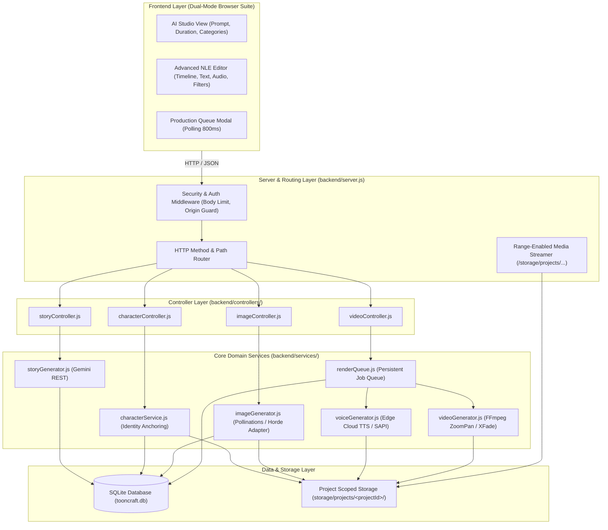

# SYSTEM ARCHITECTURE SPECIFICATION
**Project:** `youtube-cartoon-agent`  
**System:** ToonCraft AI Studio & Advanced NLE Video Editor  
**Status:** Stage A Architectural Baseline & Hardening Design  

---

## 1. Architectural Overview & Design Principles

The application is structured around a **Dual-Mode Workspace**:
1. **AI Creation Studio (`mainAiStudioView`):** Fast creation pipeline (Prompt $\rightarrow$ Screenplay $\rightarrow$ Character Extraction $\rightarrow$ Scene Storyboarding $\rightarrow$ 1-Click Master Render).
2. **Advanced Video Editor (`advancedVideoEditorView`):** Non-linear video editing console (CapCut/Premiere style) with 10 inspector categories, multi-track timeline, keyframes, custom text overlays, filters, transitions, audio mixing, and color grading.

### Core Architectural Goals for Production Hardening
* **Complete Project Data Isolation:** Every project operates within its own directory tree (`storage/projects/<projectId>/...`). Operations on Project A must never touch Project B.
* **Relational Persistence:** SQLite (`better-sqlite3`) replaces fragile flat JSON files (`characters.json`, `projects.json`), enforcing foreign key constraints and ACID transactions.
* **Asynchronous Multi-Stage Queue:** Render jobs and long-running AI synthesis tasks run in an observable queue with persistent state, progress reporting, and safe cancellation.
* **Provider Portability:** Central provider abstractions decouple business logic from specific AI vendors (Gemini, Pollinations, AI Horde, Replicate, Edge TTS).

---

## 2. System Architecture Diagrams

### 2.1 Component Interaction Diagram



---

### 2.2 Production Pipeline Data Flow

```mermaid
sequenceDiagram
    autonumber
    actor User as Creator / Browser
    participant Server as HTTP Server & Queue
    participant Gemini as Google Gemini REST API
    participant ImageGen as Pollinations / AI Horde
    participant Voice as Edge TTS Service
    participant FFmpeg as FFmpeg Video Engine
    participant DB as SQLite Database

    User->>Server: POST /api/generate-storyboard (Prompt, Category, Duration)
    Server->>Gemini: generateContent (Structured JSON Screenplay)
    Gemini-->>Server: Screenplay JSON (Acts, Dialogue, Descriptions)
    Server->>DB: Save Storyboard & Auto-Extract Characters
    Server-->>User: Return Storyboard + Characters List
    
    User->>Server: POST /api/lock-character (characterId, locked=true)
    Server->>DB: Update character locked state
    
    User->>Server: POST /api/generate-scene-image (sceneNumber, prompt)
    Server->>DB: Fetch Locked Character Anchors (face, hair, eyes, costume)
    Server->>ImageGen: Generate 9:16 Vertical Image (Prompt + Anchors)
    ImageGen-->>Server: Binary Image Buffer
    Server->>Server: Lanczos Upscale & Store in storage/projects/<id>/scenes/
    Server-->>User: Return Scene Thumbnail URL
    
    User->>Server: POST /api/render-job/start (projectId, settings)
    Server->>DB: Insert Render Job (Status: queued, Progress: 5%)
    Server-->>User: Return jobId
    
    rect rgb(20, 30, 45)
        Note over Server,FFmpeg: Background Asynchronous Processing
        Server->>Voice: Generate Narration Audio (.wav)
        Voice-->>Server: cartoon-narration.wav + duration
        Server->>DB: Update Job (Status: processing, Progress: 25%)
        
        Server->>FFmpeg: Render 2.5D Camera Motion Clips (zoompan, tilt, pan)
        FFmpeg-->>Server: scene_clip_1.mp4 ... scene_clip_N.mp4
        Server->>DB: Update Job (Progress: 60%)
        
        Server->>FFmpeg: Multi-Scene Cinematic XFade Blending
        FFmpeg-->>Server: stitched_storyboard.mp4
        Server->>DB: Update Job (Progress: 80%)
        
        Server->>FFmpeg: Composite Audio Waveform + Vignette + Subtitles
        FFmpeg-->>Server: final-cartoon-short.mp4
        Server->>DB: Update Job (Status: completed, Progress: 100%)
    end
    
    loop Every 800ms
        User->>Server: GET /api/render-job/status?jobId=...
        Server-->>User: Progress %, Current Stage, Video URL
    end
```



---

## 3. Project-Scoped Storage Hierarchy

To eliminate the critical risk of cross-project data contamination, all assets are organized by a sanitized `projectId`:

```text
storage/
└── projects/
    └── <projectId>/
        ├── project.json                 # Project configuration snapshot
        ├── characters/
        │   ├── <characterId>_front.png  # Primary locked reference portrait
        │   ├── <characterId>_profile.png
        │   └── <characterId>_closeup.png
        ├── scenes/
        │   ├── scene1.png               # High-res generated still
        │   ├── scene1_clip.mp4          # 2.5D animated video clip
        │   ├── scene2.png
        │   └── scene2_clip.mp4
        ├── audio/
        │   ├── narration.wav            # Synthesized multi-lingual speech
        │   ├── narration.mp3
        │   └── custom_bgm.mp3           # Soundtrack
        └── exports/
            ├── render_<jobId>.mp4       # Unique master video output
            └── thumbnail_<jobId>.jpg    # Final video poster image
```

---

## 4. Key Architectural Invariants

1. **Deterministic Path Resolution:** No filesystem path may be formed without validating that `path.resolve(targetPath)` begins with the project's base directory.
2. **Non-Blocking Execution:** The main HTTP thread never blocks on video rendering; all FFmpeg jobs are managed by the asynchronous background queue.
3. **Atomic Writes:** Database records are updated within transactions, ensuring that failed render or generation attempts leave no half-written metadata.
4. **Idempotent Asset Caching:** Scene clips are hashed and reused if neither the prompt, the character lock, nor the source image timestamp has changed.
